<!-- ═══════════════════════════════════════════════════════════════════════════
     01 // ANIMATED PURPLE CYBERPUNK HERO BANNER
════════════════════════════════════════════════════════════════════════════ -->

<!-- ── Dual Animated Glowing Typewriters ── -->

 

  

<!-- ── Glowing Action & Social Pills ── -->

  
  
  
  

<!-- ═══════════════════════════════════════════════════════════════════════════
     02 // ANIMATED NEURAL CORE & LIVE DATA PACKET NETWORK
════════════════════════════════════════════════════════════════════════════ -->
 

  

<!-- ═══════════════════════════════════════════════════════════════════════════
     03 // VISUAL TECH ARSENAL (ICON DOCKS)
════════════════════════════════════════════════════════════════════════════ -->

 

<table>
<tr>
<td align="center" width="33%">
  <b>🧠 AI · VISION · DATA</b>  
  
</td>
<td align="center" width="34%">
  <b>⚡ FRONTEND · 3D · MOTION</b>  
  
</td>
<td align="center" width="33%">
  <b>🚀 BACKEND · CLOUD · WEB3</b>  
  
</td>
</tr>
</table>

<!-- ═══════════════════════════════════════════════════════════════════════════
     04 // VISUAL SHOWCASE MATRIX — DEPLOYED BUILDS
════════════════════════════════════════════════════════════════════════════ -->

 

<table>
<tr>
<td width="50%" align="center">
  
   
  
   
  <code>FastAPI · LangGraph · SimPy · PostgreSQL · Next.js</code>
</td>
<td width="50%" align="center">
  
   
  
   
  <code>Python · Gemini Vision · A/B Model Eval · Multi-Modal</code>
</td>
</tr>
<tr>
<td width="50%" align="center">
  
   
  
   
  <code>React 18 · Capacitor · Gemini 1.5 · Twilio · Zustand</code>
</td>
<td width="50%" align="center">
  
   
  
   
  <code>React · FastAPI · Firebase FCM · n8n · Ollama OCR</code>
</td>
</tr>
<tr>
<td width="50%" align="center">
  
   
  
   
  <code>React 19 · Next.js 16 · Three.js / R3F · GSAP · Lenis</code>
</td>
<td width="50%" align="center">
  
   
  
   
  <code>Python · MediaPipe · OpenCV · OpenGL · 30 FPS HUD</code>
</td>
</tr>
</table>

 

<!-- ── Compact Milestone Badges ── -->

  
  
  

<!-- ═══════════════════════════════════════════════════════════════════════════
     05 // CREATIVE PURPLE CONTRIBUTION CHART ANIMATIONS
════════════════════════════════════════════════════════════════════════════ -->

 

<!-- 1. Custom Animated Purple Cyber-Matrix, Laser Scanner & Spline Wave -->

  

<!-- 2. Live Purple Neon Commit Activity Wave -->

  

<!-- 3. Purple Glow Streak & Telemetry HUD Cards -->

  
  

  
  

<!-- ═══════════════════════════════════════════════════════════════════════════
     06 // ANIMATED WAVING PURPLE FOOTER
════════════════════════════════════════════════════════════════════════════ -->

